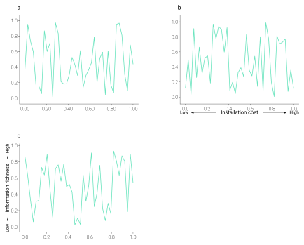

Layout Utilities
================

Utilities for tightening layouts without juggling ``plt.subplots_adjust``.
``simple_layout`` measures visible artists and arithmetically places GridSpec
edges so axes content lands at the requested distance from the figure bounds;
``make_offset`` nudges text/legends in point units; ``label_axes`` adds
standardized panel labels; ``annotate_value``, ``annotate_corner``, and
``label_hline`` create compact point-offset labels; ``label_bars`` writes each
bar's value on it, printed like the axis ticks; ``place_legend`` chooses
data/text-aware axes legend positions and can raise legend columns, or puts the
legend outside one side (``loc="above"``, ``"below"``, ``"right"``,
``"left"``), and merges a twin pair's legends into one; ``arrow_axis``
draws annotated bidirectional arrows; and ``wrap_axis_label`` /
``set_decimal``/``get_bounding_box`` provide quick helpers when formatting axes.

Example
-------

.. code-block:: python

   import numpy as np
   import dartwork_mpl as dm

   fig, axes = plt.subplots(1, 3, figsize=dm.figsize(dm.col2, 0.35))
   for ax in axes:
       ax.plot(np.linspace(0, 1, 40), np.random.rand(40), color='dc.teal3')

   # Panel labels
   dm.label_axes(axes)  # adds a, b, c

   # Layout optimization
   dm.simple_layout(fig, ml=0.08, mr=0.05, mb=0.10, mt=0.08)

   # Decimal formatting
   dm.set_decimal(axes[0], xn=2, yn=1)

   # Arrow annotations
   dm.arrow_axis(axes[1], 'x', 'Installation cost')
   dm.arrow_axis(axes[2], 'y', 'Information richness')

API
---

Layout Functions
^^^^^^^^^^^^^^^^

.. note::

   ``cm2in`` / ``set_xmargin`` / ``set_ymargin`` were removed in the 0.4
   release. Use ``dm.cm(...)`` (which returns a ``Length``) and
   matplotlib's ``ax.margins(...)`` instead — see the migration table in
   :doc:`../migration`.

.. autofunction:: dartwork_mpl.simple_layout

Annotation Functions
^^^^^^^^^^^^^^^^^^^^

.. autofunction:: dartwork_mpl.make_offset
.. autofunction:: dartwork_mpl.label_axes
.. autofunction:: dartwork_mpl.annotate_value
.. autofunction:: dartwork_mpl.annotate_corner
.. autofunction:: dartwork_mpl.add_note
.. autofunction:: dartwork_mpl.label_hline
.. autofunction:: dartwork_mpl.label_line_ends
.. autofunction:: dartwork_mpl.place_legend
.. autofunction:: dartwork_mpl.wrap_axis_label
.. autofunction:: dartwork_mpl.wrap_axis_labels
.. autofunction:: dartwork_mpl.arrow_axis

Value Labels on Bars
^^^^^^^^^^^^^^^^^^^^

Provisional (listed in ``dartwork_mpl.EXPERIMENTAL``): the placement,
crowding and stacked-total rules may still change in a minor release.
:func:`~dartwork_mpl.simple_layout` settles the labels' crowding and
headroom at the size it fits.

.. code-block:: python

   import matplotlib.pyplot as plt
   import dartwork_mpl as dm

   dm.style.use("report")
   fig, ax = plt.subplots(figsize=dm.figsize("12cm", "standard"))
   ax.bar(["A", "B", "C"], [120, 135, 98])
   dm.label_bars(ax)                     # 120, 135, 98 above the bars
   # dm.label_bars(ax, where="inside")   # a request: that keyword
   dm.simple_layout(fig)

.. autofunction:: dartwork_mpl.label_bars

Utility Functions
^^^^^^^^^^^^^^^^^

.. autofunction:: dartwork_mpl.layout.get_bounding_box
.. autofunction:: dartwork_mpl.set_decimal
