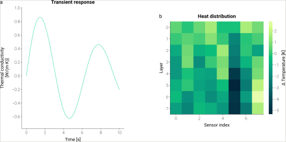
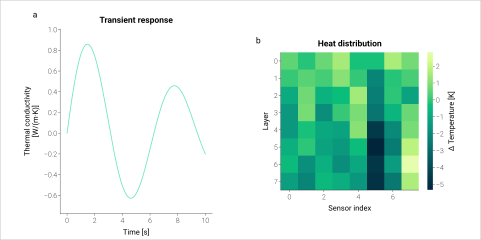

# Layout and Typography

## Layout optimization

For most figures, `simple_layout(fig)` is all you need — it automatically
optimizes margins so labels and titles don't clip or overlap:

```python
import matplotlib.pyplot as plt
import dartwork_mpl as dm
import numpy as np

dm.style.use("scientific")

fig, ax = plt.subplots(figsize=dm.figsize("15cm", "wide"))
ax.plot(np.linspace(0, 10, 100), np.sin(np.linspace(0, 10, 100)), color="dc.teal3")
ax.set_xlabel("Time [s]")
ax.set_ylabel("Response")

dm.simple_layout(fig)  # replaces fig.tight_layout — flush to figure edges
```

**Try it — drag the sliders to see how figure dimensions map onto an A4 page:**

```{raw} html
:file: images/ruler_widget.html
```

### Multi-panel figures

For multi-panel layouts, use GridSpec and pass it to `simple_layout`:

```python
fig = plt.figure(figsize=dm.figsize("15cm", "portrait"))
gs = fig.add_gridspec(2, 2, hspace=0.35, wspace=0.25)
axes = [fig.add_subplot(gs[i, j]) for i in range(2) for j in range(2)]

for ax in axes:
    ax.plot(np.linspace(0, 1, 40), np.random.rand(40), color="dc.teal3", lw=0.8)

dm.label_axes(axes)                    # adds (a), (b), (c), (d) panel labels
dm.set_decimal(axes[0], xn=2, yn=1)    # format tick labels to fixed decimals

# Pass gs so simple_layout respects your GridSpec spacing
dm.simple_layout(fig, gs=gs)
```

:::{figure} images/layout_gridspec.svg
:alt: 2×2 GridSpec layout with panel labels and decimal formatting
:width: 100%
:::

> **Tip:** You generally don't need to set explicit `left`, `right`, `top`,
> `bottom` values on GridSpec — `simple_layout` finds optimal margins
> automatically. Only add manual margins when you need fine positional control
> (e.g., making room for a colorbar or external legend).

## Native multi-panel layouts

Use this setup, choose **one** construction below, then run the shared drawing
and export block. These are executable native matplotlib recipes, not another
layout API. Keep the existing preset, data, colors, fonts, legend and retained
scoped overrides when adapting an existing figure. The example uses a provisional
20 × 16 cm canvas; choose physical dimensions for your page or slide.

```python
import matplotlib.pyplot as plt
import numpy as np
import dartwork_mpl as dm

# Reuse the selected preset for geometry-only revisions.
dm.style.use("scientific")  # report/document: report; talk/slides: presentation
x = np.linspace(0, 12, 121)
fig = plt.figure(figsize=dm.figsize("20cm", "16cm"))
```

### Whole-figure estimate, template guidance and margin correction

`dm.figsize_grid("6cm", "standard", ncols=3, nrows=2, gap="0.6cm")`
returns a whole-figure size: width `3 * 6 + 2 * 0.6 = 19.2cm` and height
`2 * (6 * 0.75) + 0.6 = 9.6cm`. It does not create Axes or set GridSpec
spacing. The requested panel width and gap are inputs to that arithmetic;
labels, outer margins and native `wspace`/`hspace` determine the final Axes
rectangles and gaps. Neither exact 6cm Axes nor exact 0.6cm rendered gaps
are guaranteed. Render and measure the bounds below when those matter.

MCP `compose_layered_plot` returns a starting template (including its example
comments) and an annotation-layer checklist for the agent to adapt. Its
`applied`/`missing` lists use lexical detection in source, not rendered checks.
It does not rewrite code, execute a plot, allocate panels or repair spacing.
Installed Python users can read the same basic/advanced sources through
`importlib.resources`, as shown in the [installed workflow](../ai/installed_python.md).

The bounded margin/convergence correction tracked by #209 is a separate
concern from template composition and figure-size arithmetic. The current
`dm.simple_layout` measures content and iteratively updates root GridSpec outer
margins, preserving native internal spacing. It does not solve nested local
spacing or guarantee that every label fits every requested canvas. Historical
`auto_layout` is removed; do not call it as an extra correction pass.
`simple_layout` returns `None`, not a convergence or validation report: inspect
`dm.validate_figure(fig)` findings and the actual PNG/PDF before accepting the
result. If content cannot fit the requested geometry, explain the constraint
and agree on a revision; do not silently delete data or shrink fonts.

### Equal grid

```python
gs = fig.add_gridspec(2, 2, wspace=0.5, hspace=0.65)
axes = {name: fig.add_subplot(gs[i // 2, i % 2])
        for i, name in enumerate("ABCD")}
```

### Global row and column ratios

Every row shares the 2:1 column widths; every column shares the 3:2 row heights.
These ratios concern data rectangles inside the grid, excluding gaps and outer
content margins. They do not partition the entire canvas into percentages.

```python
gs = fig.add_gridspec(2, 2, width_ratios=[2, 1], height_ratios=[3, 2],
                      wspace=0.5, hspace=0.65)
axes = {name: fig.add_subplot(gs[i // 2, i % 2])
        for i, name in enumerate("ABCD")}
```

### Spanning, asymmetric and nested

A spans both rows; D spans the lower right region. B/C share a nested grid.
The shared finish fits outer margins through the root `gs`; nested spacing
remains a native local choice.

```python
gs = fig.add_gridspec(2, 3, wspace=0.75, hspace=0.65)
inner = gs[0, 1:].subgridspec(1, 2, width_ratios=[1, 2], wspace=0.8)
axes = {"A": fig.add_subplot(gs[:, 0]),
        "B": fig.add_subplot(inner[0, 0]),
        "C": fig.add_subplot(inner[0, 1]),
        "D": fig.add_subplot(gs[1, 1:])}
```

### Whole-canvas top 70%, bottom 30%

Here `SubFigure` regions include all local labels and padding. Zero container
spacing makes their heights exactly 70%/30% of the canvas. This explicit 2×1
construction gives each row one full-width plot. Data rectangles become smaller
after local margins.

```python
rows = list(fig.subfigures(2, 1, height_ratios=[7, 3], hspace=0))
panels = rows
axes = {}
for name, panel in zip("AB", panels):
    width_cm = panel.bbox.width / fig.dpi * 2.54
    height_cm = panel.bbox.height / fig.dpi * 2.54
    local = panel.add_gridspec(
        1, 1, left=1.15 / width_cm, right=1 - 0.45 / width_cm,
        bottom=1.05 / height_cm, top=1 - 0.80 / height_cm)
    axes[name] = panel.add_subplot(local[0])
```

For a 2×2 variant with two equal panels per row, replace `panels = rows` with
`panels = [panel for row in rows for panel in row.subfigures(1, 2, wspace=0)]`
and use `zip("ABCD", panels)`. The row containers remain exactly 70%/30%.

### Whole-canvas rows 50:50, top widths 40:60, bottom 70:30

A single global `width_ratios` cannot express this. Allocate independent native
containers within each row. Every percentage includes that panel's labels and
padding; it is not a promise about its Axes data width.

```python
rows = list(fig.subfigures(2, 1, height_ratios=[1, 1], hspace=0))
panels = [*rows[0].subfigures(1, 2, width_ratios=[4, 6], wspace=0),
          *rows[1].subfigures(1, 2, width_ratios=[7, 3], wspace=0)]
axes = {}
for name, panel in zip("ABCD", panels):
    width_cm = panel.bbox.width / fig.dpi * 2.54
    height_cm = panel.bbox.height / fig.dpi * 2.54
    local = panel.add_gridspec(
        1, 1, left=1.15 / width_cm, right=1 - 0.45 / width_cm,
        bottom=1.05 / height_cm, top=1 - 0.80 / height_cm)
    axes[name] = panel.add_subplot(local[0])
```

### Shared drawing, measurement and export

Run this after the chosen construction. For the three ordinary grids use the
`simple_layout` line. For either whole-canvas container recipe **omit that line**:
the explicit native local margins above are the legitimate margin path.
The physical padding is a starting point for these labels, not a universal fit;
render, measure and adjust local margins if content does not fit.

<!-- snippet: no-run -->
```python
from dataclasses import asdict
from pathlib import Path
import json
from matplotlib.ticker import MaxNLocator

for i, (name, ax) in enumerate(axes.items()):
    ax.plot(x, np.sin(x + i), color="oc.blue9", label="Series 1")
    ax.plot(x, np.cos(x + i), color="oc.orange7", label="Series 2")
    ax.set(title=f"{name} · Signal", xlabel="Time (s)", ylabel="Response")
    ax.xaxis.set_major_locator(MaxNLocator(nbins=4))
    ax.yaxis.set_major_locator(MaxNLocator(nbins=4))
    ax.legend(loc="upper right", ncol=2)

# Ordinary GridSpec recipes only; omit for either SubFigure recipe.
dm.simple_layout(fig, gs=gs, margin="2mm")
fig.canvas.draw()
renderer = fig.canvas.get_renderer()
geometry = {"canvas_px": list(fig.bbox.bounds),
            "axes_data_px": {k: list(a.bbox.bounds) for k, a in axes.items()},
            "axes_content_px": {k: list(a.get_tightbbox(renderer).bounds)
                                for k, a in axes.items()}}
# For either container recipe, also record the allocated regions:
# geometry["rows_px"] = [list(row.bbox.bounds) for row in rows]
# geometry["panels_px"] = [list(panel.bbox.bounds) for panel in panels]
# Divide row heights by fig.bbox.height; panel widths by their row width.
# Compare those fractions to the requested ratios, separately from Axes bounds.
report = [asdict(item) for item in dm.validate_figure(fig)]
Path("output").mkdir(exist_ok=True)
Path("output/layout-geometry.json").write_text(json.dumps(geometry, indent=2))
Path("output/layout-report.json").write_text(json.dumps(report, indent=2))
dm.save_formats(fig, "output/layout-v1", formats=("png", "pdf"),
                bbox_inches=None)
```

`dm.simple_layout` needs a parent `Figure`; passing a `SubFigure` raises
`AttributeError` for missing `get_size_inches`. Passing a nested GridSpec with a
parent Figure walks to its root GridSpec and adjusts root outer margins; it
does not solve each nested region independently. Calling it on the root Figure
of a SubFigure tree is not a local-margin solution either. Do not insert fake
helper calls or silently change requested allocations to make validation pass.
Read the full report (including `CHECK_FAILED`), inspect the actual PNG and PDF,
and retain heuristic/advisory warnings with any explanation. Save a revision to
a new stem such as `layout-v2`; keep v1, exact source and geometry for review.

### Measured presentation text correction

For the two whole-canvas recipes above, a measured 20 × 16 cm render using
`presentation` clipped the leftmost `Response` y-label with the initial
1.15 cm local left margin. Increasing only that margin to 1.70 cm cleared
that overflow in both examples. After inspecting the full report and images,
a revision can replace the `local = panel.add_gridspec(...)` call inside the
existing panel loop with:

<!-- snippet: no-run -->
```python
# This measured example's candidate, not a universal fit value.
local = panel.add_gridspec(
    1, 1, left=1.70 / width_cm, right=1 - 0.45 / width_cm,
    bottom=1.05 / height_cm, top=1 - 0.80 / height_cm)
```

Rebuild the figure with that local edit, then repeat drawing, measurement,
validation and image review, saving to a new output stem. Keep the 20 × 16 cm
canvas, requested container ratios, data, colors, preset fonts and legend
anchors. The larger left margin makes the data Axes narrower; it does not
change the container allocations. The value 1.70 cm is a candidate for these
measured examples, not an automatic preset override. If too little data space
remains or content still clips, explain the constraint and ask which constraint
may change; do not silently shrink fonts, remove data, resize the canvas or
relocate legends. The scientific recipe defaults above remain unchanged.

### Adding a buffer with `margin`

The default `simple_layout(fig)` snaps axes content (labels, ticks,
title, legend) flush against the figure edges. For a uniform inset
buffer, pass a `margin`:

```python
fig, ax = plt.subplots(figsize=dm.figsize("9cm", "standard"))
ax.plot(np.linspace(0, 10, 100), np.sin(np.linspace(0, 10, 100)))
ax.set_ylabel("Very Long Label That Might\nOverflow the Figure Bounds")
ax.set_title("Complex Multi-Line Title", fontsize=dm.fs(2))

dm.simple_layout(fig, margin="2%")        # uniform 2% buffer
dm.simple_layout(fig, margin=dm.mm(2))    # uniform 2 mm buffer
dm.simple_layout(fig, ml=dm.cm(1), mr="3%")  # per-side, mixed units
```

`margin` (and the per-side `ml`/`mr`/`mt`/`mb` overrides) accept any
of:

- :class:`Length` (`dm.cm(0.5)`, `dm.mm(5)`, `dm.inch(0.1)`,
  `dm.pt(12)`)
- unit string (`"5mm"`, `"0.5cm"`, `"0.1in"`, `"24pt"`)
- percentage string (`"5%"` = 5 % of the figure dimension)
- bare number (figure-fraction, so `0.05` = 5 %)

All four effective side margins must resolve to finite figure fractions.
Otherwise, `simple_layout` raises
`ValueError("margin must resolve to finite figure fractions")` before drawing,
font adoption or layout changes. All margins are parsed first, so an invalid
margin string still raises its parsing error. Four finite side overrides may
replace a nonfinite base `margin`; partial overrides must leave every side
finite. Finite zero, negative and oversized margins retain the existing edge
clamp. Empty figures and figures without a supported GridSpec return before
parsing margins; the latter retain their warning.

**How it works:**

1. Draws the figure once to populate text metrics.
2. Walks every visible artist on each axes (texts, title, axis labels,
   tick labels in view, axis offset text, legend; the tick labels and
   label of a `secondary_xaxis` / `secondary_yaxis` count as that axes'
   own) and computes the content-extent overhang relative to each axes'
   plot area.
3. Sets GridSpec edges arithmetically so the union of all axes
   content sits at exactly the requested distance from each figure
   edge.
4. Re-measures and re-applies until consecutive iterations agree to
   within 0.5 px (typically 2 iterations; up to 8 on AutoLocator
   fixed-points like long log-scale ranges).

No optimizer is involved — the result is fully deterministic.

### Data-range margins on individual axes

`dm.simple_layout` controls margins between the **axes content** and
the **figure edge**. For breathing room between the **plotted data**
and the **axes spines**, use matplotlib's built-in
`ax.margins(...)` — dartwork-mpl doesn't wrap it, since it's already a
one-liner:

```python
ax.margins(x=0.1, y=0.05)   # 10 % x-padding, 5 % y-padding
ax.margins(0.05)            # same value on both axes
```

Useful for:

- Preventing data from touching axis spines
- Creating visual breathing room around markers
- Ensuring scatter points and bar tops aren't clipped at boundaries

### Which call to use?

| Scenario | Call |
|---|---|
| Default — most figures | `dm.simple_layout(fig)` |
| Need a buffer between content and edge | `dm.simple_layout(fig, margin="2%")` or `margin=dm.mm(2)` |
| Per-side asymmetric margins | `dm.simple_layout(fig, ml=dm.cm(1), mr="3%", ...)` |
| Multi-panel via GridSpec | `dm.simple_layout(fig, gs=gs)` |
| Debugging layout convergence | `dm.simple_layout(fig, verbose=True)` |

The historical `dm.auto_layout(fig)` was removed in 0.5.4 and now
raises a migration-hint `AttributeError`. Use `simple_layout` directly.

### `simple_layout` vs `tight_layout`

Simple layouts look fine with either method. The real difference shows up when
figures get more complex — multi-panel grids, long axis labels, colorbars, and
titles all competing for space.

**Interactive visualizer — see how dartwork-mpl calculates margins dynamically:**

```{raw} html
:file: images/layout_debugger.html
```

Below is the **same figure** — a two-panel layout with a multi-line
y-label and a colorbar — rendered with each approach. The figure
background is tinted and edged so you can see how each method
negotiates the gap between the axes content and the figure rectangle
itself. **Click the tabs to toggle** the full-width rendering — that's
the only way to spot the lopsided whitespace and the shifted colorbar
without overlaying the two side-by-side.

::::{tab-set}

:::{tab-item} `simple_layout()` (dartwork-mpl)
:sync: dm


:::

:::{tab-item} `tight_layout()` (matplotlib)
:sync: mpl


:::

::::

**What's different?**

`tight_layout()` calculates padding heuristically — it tries to prevent
overlap but doesn't guarantee uniform margins or optimal use of space. When
panels have **different label lengths** (e.g., a multi-line ylabel vs. a
short one), or when a **colorbar** shifts the effective axes width, the
heuristic can produce lopsided spacing or wasted whitespace.

`simple_layout()` measures every visible artist on every axes and
arithmetically places the GridSpec so the content union lands at the
requested margin from each figure edge. This means:

- **Deterministic** — the same figure produces the same GridSpec
  (no optimizer, no scipy)
- **Content-complete** — sees titles, axis labels, view-limited tick
  labels, ScalarFormatter offset text, legends — everything that
  appears on the canvas
- **GridSpec-native** — pass `gs=gs` and it respects your
  `hspace`/`wspace` while only adjusting outer margins
- **Unit-flexible** — `margin` accepts `Length`, unit strings (`"5mm"`),
  percentages (`"5%"`), or figure-fractions

**Key layout functions** — the full layout API at a glance (for the
`simple_layout` margin / GridSpec options specifically, see
[Which call to use?](#which-call-to-use) above):

| Function                      | What it solves                                                |
| ----------------------------- | ------------------------------------------------------------- |
| `simple_layout(fig, gs=gs)`   | Places content at requested margin — replaces `tight_layout()` |
| `label_axes(axes)`            | Adds (a), (b), (c) labels with auto-positioning for ylabels   |
| `annotate_value(ax, x, y, s)` | Adds compact value labels with vertical/horizontal fallback    |
| `label_bars(ax)`              | Writes each bar's value on it, printed like the ticks; `simple_layout` settles crowding and headroom |
| `annotate_corner(ax, s)`      | Adds spine-tight narrative notes in the least obstructed corner |
| `label_hline(ax, y, s)`       | Attaches text tightly to a horizontal reference-line endpoint  |
| `place_legend(ax)`            | Places legends around data/text obstacles and can raise ncol; one legend for a twin pair |
| `place_legend(ax, loc="above")` | Puts the legend outside one side (`above`/`below`/`right`/`left`), past the tick labels; `simple_layout` keeps titles above it |
| `wrap_axis_label(ax)`         | Wraps an overlong axis label to two word-boundary lines        |
| `arrow_axis(ax, 'x', 'Cost')` | Creates `Low ◄── Cost ──► High` bidirectional annotations     |
| `set_decimal(ax, xn, yn)`     | Fixes tick label decimals with a dynamic formatter; locator and limits stay |
| `make_offset(x, y, fig)`      | Point-unit offset transform (Figure DPI) for precise text positioning |
| `get_bounding_box(boxes)`     | Merges multiple axes bounding boxes into one                  |

## Annotation & Formatting

dartwork-mpl includes several helpers that automate tedious formatting tasks.

### Panel labels (`label_axes`)

`dm.label_axes` accepts `labels` for custom strings and `x` / `y` for
Axes-relative positions (values may extend outside 0–1). With `x="auto"`,
it uses -0.18 when an Axes has a y-label and -0.02 otherwise; `y` defaults
to 1.05. Extra compatible native `Text` properties, such as `color`,
`rotation` and `alpha`, pass through to `ax.text`:

```python
import matplotlib.pyplot as plt
import dartwork_mpl as dm

dm.style.use("scientific")
fig, ax = plt.subplots(figsize=dm.figsize("9cm", "standard"))
ax.plot([0, 1, 2], [1, 3, 2], color="oc.blue9")
dm.label_axes([ax], labels=["(a)"], x=-0.02, y=1.05,
              color="black", rotation=0, alpha=0.9)
dm.simple_layout(fig)
```

`fmt`, `loc` and `xy` are not supported `label_axes` arguments. Use
`labels` for text and `x` / `y` for position. The helper supplies the Axes
transform and left/bottom alignment itself; for custom transforms or
alignment, replace the preceding `dm.label_axes(...)` call with the native
call below, before `dm.simple_layout(fig)`. Do not run both label calls:

<!-- snippet: no-run -->
```python
ax.text(0.02, 0.98, "(a)", transform=ax.transAxes,
        fontsize=dm.fs(1), ha="left", va="top")
```

Panels with a left-aligned title (`ax.set_title(..., loc="left")`) get the
letter on the title's line, just before the title (`a  Line A`), and it moves
with the title; a centre title moves the letter only when it would touch it.
Set the titles first. An explicit `x=` keeps the old fixed position.

**Interactive visualizer — drag the slider to compare:**

```{raw} html
:file: images/label_axes_slider.html
```

### Tick numbers and dates you did not format

`dm.simple_layout(fig)` settles the numbers of every axis still on
matplotlib's default formatter, so the same data reads the same in every
figure:

| Axis | Ticks |
|---|---|
| reaches 1,000 | `0, 250 … 1,750`; `24,000 … 34,000` |
| reaches one million | `0, 0.5M … 2.5M` (the largest tick's unit) |
| reaches one million, Korean axis labels, titles or legend | `0, 50만 … 250만` (만/억/조) |
| below 1,000 | unchanged: `0, 250 … 750` |
| a `secondary_xaxis` / `secondary_yaxis` whose functions are affine (the same values, `×1.3`, °C shown as °F) | the parent's rules: `1,600 … 2,400`; `0.5M`. A curved one (`1 / x`) keeps matplotlib's, as log axes do |
| an x axis whose plotted data are all integers in 1900–2099 (annual lines, bars, grouped bars, scatter, `stackplot` / `fill_between` areas; a `secondary_xaxis` showing them too; also non-year data such as elevations), or a y axis whose data *positions* are such years (horizontal bars `ax.barh(range(2014, 2025), …)`, grouped too, `fill_betweenx` spans; a `secondary_yaxis` following them). A line's, scatter's or bar's y values are quantities and keep their numbers (`1,985 … 2,045`) | ticks on whole years only, two digits: `16, 18 … 24`; four digits when two ticks would read alike (`1900`, `2000`) or with `tick_years=4`. Zoomed under two whole years, every tick prints its value: `2023.2 … 2023.7`, never a rounded year or an empty label |
| monthly dates | `23.01, 23.07, 24.01` (year, then month; two-digit years) |
| quarterly dates | `23.Q1, 23.Q3, 24.Q1` |
| dates on a narrow axis | fewer ticks until labels are one em apart |

Korean figures print the same dates and years, without a suffix.

The rule: no request, the library default; a request, that format.
`ax.ticklabel_format(...)` is such a request: `style="plain"` prints full
numbers (`500000`) where the default would read `0.5M`, and scientific
notation or an offset gets matplotlib's own formatter. One limit: before
`dm.simple_layout`, a request equal to matplotlib's own defaults
(`style="sci"` alone, `useOffset=True`, `scilimits=` equal to the rc
`axes.formatter.limits`) changes nothing matplotlib records, so it cannot
be told from no request and the library's ticks stay. Call it after the
layout, or set `ax.xaxis.set_major_formatter(ScalarFormatter())` first. A
prompt
can ask for three other formats, one `dm.config` field each:
`tick_years=4` (four-digit years: `2016`, `2023.01`), `date_style="concise"`
(matplotlib's concise words: `23, May, Sep`; `2023, May, Sep` with
`tick_years=4`) and `number_ladder="si"` (`k/M/G/T` in Korean figures too).

```python
with dm.config.override(tick_years=4):        # four-digit years
    fig, ax = plt.subplots(figsize=dm.figsize("9cm", "standard"))
    ax.plot(range(2016, 2025), range(9))
    dm.simple_layout(fig)                     # 2016, 2017 … 2024
```

`dm.config.override(...)` is a context manager: a bare call changes nothing.
It applies to what runs inside the `with` block, so wrap the code from
figure creation to the last `dm.simple_layout` (and the save), or set the
field on `dm.config` for the whole program (`dm.config.tick_years = 4`). A
formatter or locator you set yourself is never replaced. Labels you fix,
as in `ax.set_xticklabels(ax.get_xticklabels(), rotation=45)`, keep the
ticks they were made for: the layout pins those ticks, since matplotlib
gives fixed texts to ticks by order. Pinned ticks stay: a later
`ax.set_xlim` zoom shows no new ones (0–5,000 zoomed to 1,000–2,500 keeps
two). To rotate labels without fixing their
text, `ax.tick_params(axis="x", rotation=45)` keeps the library's ticks.
A tick count asked
of the axis, `ax.locator_params(axis="x", nbins=3)`, is kept on whole years
(`00, 10, 20`); that is the way to ask for fewer ticks. Under a locator you
set (`MaxNLocator`) year data read years while every tick is a whole year
(`05, 10`) and plain numbers when one falls between years (`2005.0,
2007.5`), decided at each draw, whether you set it before or after
`dm.simple_layout`.
`dm.simple_layout(fig, format_ticks=False)` keeps matplotlib's numbers;
`dm.format_axis_si(ax)` or `dm.format_axis_myriad(ax)` give `1.75k` or
`0.25억` on the ticks.

To print the unit once, in the axis label, use `dm.axis_unit`:

```python
dm.axis_unit(ax, "y", label="Exports (USD {unit})", ladder="finance")  # 40 … 70 · Exports (USD B)
dm.axis_unit(ax, "y", label="인구 ({unit}명)")   # 0, 0.2 … 1.0 · 인구 (억명)
unit = dm.axis_unit_of(ax)                       # the unit, for value labels
```

The default rule is the largest unit on the axis (`scale="max"`); the ticks
stay plain numbers.

### Consistent tick decimals (`set_decimal`)

Raw matplotlib ticks can sometimes mix integers and floats (e.g. `0.5`, `1`, `1.5`), which looks unprofessional. `dm.set_decimal()` formats every tick label, now and after the view changes, with the same number of decimals. It installs a `FuncFormatter` and leaves the axis locator and limits as they are.

```{raw} html
:file: images/set_decimal_slider.html
```

### Compact value and reference labels

`dm.annotate_value(ax, x, y, text)` uses a small point offset above the data
point by default, tries below when vertical placement collides, and falls back
to left/right placement when the label would cross the axes spine. Explicit
`side="left"` / `side="right"` also works with `arrowprops`, keeping the arrow
straight along one axis. `dm.annotate_corner(ax, text)` places narrative notes
just inside a corner and can move to a less obstructed corner after rendering.
`dm.label_hline(ax, y, text)` keeps horizontal-reference labels close to the
visible line endpoint with a 2 pt default gap.

```python
dm.annotate_value(ax, x[-1], y[-1], f"{y[-1]:.1f}")
dm.annotate_corner(ax, "Screened subset", loc="upper left")
ax.axhline(baseline, lw=0.5, ls=":")
dm.label_hline(ax, baseline, "Reference", x="auto")
dm.place_legend(ax)
dm.wrap_axis_label(ax, axis="y")
```

### Value labels on bars (`label_bars`)

`dm.label_bars(ax)` writes each bar's value on it (an experimental helper:
its placement, crowding and stacked-total rules may still change). The
rule: no request, `dm.label_bars(ax)` with its defaults; a request, that
keyword.

```python
import matplotlib.pyplot as plt
import dartwork_mpl as dm

dm.style.use("report")
fig, ax = plt.subplots(figsize=dm.figsize("12cm", "standard"))
ax.bar(["A", "B", "C", "D"], [21.4e9, 18.0e9, 21.5e9, 33.0e9])
dm.axis_unit(ax, "y", label="Energy ({unit}Wh)")
dm.label_bars(ax)          # 21.4, 18.0, 21.5, 33.0 under Energy (GWh)
dm.simple_layout(fig)      # settles crowding and headroom
dm.save_formats(fig, "bar_labels", formats=("png", "pdf"))
```

The defaults: `dm.fs(-1)` text at `dm.fw(1)` in the preset's text colour,
3 pt beyond the bar end (below a negative bar; left of it for `barh`).
Stacked bars get each segment's label at its middle and the stack's total
beyond its end; a label on a bar takes white or the text colour, whichever
reads better on it. When a label is wider than the distance between bar
centres less 1.5 pt, `dm.simple_layout` turns the call's labels on vertical
bars vertical. Each alternative is one keyword:

| Asked for | Keyword |
|---|---|
| labels inside the bar ends, at the middle, beyond the end | `where="inside"`, `"center"`, `"outside"` (default `"auto"`: beyond a plain bar's end, at a segment's middle) |
| only the stacks' totals, or no totals | `total="only"`, `total=False` (default `"auto"`: segments and totals) |
| crowded labels: every other one hidden, or inside the bars | `crowded="skip"`, `crowded="inside"` (default `"rotate"`) |
| a fixed number of decimals | `decimals=1` |
| a unit or another number format | `fmt="{} GWh"`, `fmt="{:.2f}"`, or a callable |
| another size | `size=dm.fs(0)` |
| another colour; the bar's colour for labels off their bar | `color="dc.gray7"`; `color="series"` (labels on a bar and totals keep theirs) |

**Numbers.** A label prints like its axis's ticks. Under `dm.axis_unit` the
axis label names the unit, so the labels are plain scaled numbers (`33.0`
under `Energy (GWh)`). A formatter whose ticks carry a suffix gives the
labels the same suffix: `1.20k` under `dm.format_axis_si` (its default
`decimals=None`), `47.5%` under a
`PercentFormatter`, `33.0M` under the library's default numbers once
`dm.simple_layout` has set them. A formatter the labels cannot read
(`FuncFormatter`, `StrMethodFormatter`, `dm.format_axis_currency`) leaves
them as plain values (`12,000`); pass `fmt=` for its look. The decimals are
three significant digits on the largest value, then the fewest decimals
that print every value exactly, one count for the whole call: `21.4, 18.0,
21.5`; `120, 135`; never a meaningless `.0`. `fmt` takes a `{}` template
around that number (`"{} GWh"`), a format-spec field that formats the value
in the tick unit (`"{:.2f}"`: `21.40` under `Energy (GWh)`), or a callable
that gets the value in the tick unit and returns the whole text. A template
wraps the signed number, so `"${}B"` on −3.5 prints `$−3.5B`; for `−$3.5B`
use a callable.

**Stacks.** Containers at the same positions, each starting where the ones
before it ended (`bottom=` / `left=`), are a stack: a segment's label shows
while the segment is at least as long as the label, and the total is the
net sum. Floating bars (a waterfall) are not a stack and get one label per
bar. Pad a series split across containers with NaN, not 0: a zero can print
a `0` label.

```python
import numpy as np

fig, ax = plt.subplots(figsize=dm.figsize("12cm", "standard"))
base, top = np.array([3, 4, 2]), np.array([2, 2, 3])
ax.bar(["A", "B", "C"], base, label="Base")
ax.bar(["A", "B", "C"], top, bottom=base, label="Top")
dm.label_bars(ax)                 # 3, 4, 2 and 2, 2, 3 centred; totals 5, 6, 5
dm.place_legend(ax)
dm.simple_layout(fig)
```

**Room.** A value axis whose limits matplotlib autoscales grows just enough
to keep the outside labels and 3 pt inside the axes. Limits you set
(`ax.set_ylim`, also `ax.set_ybound`; the x ones for `barh`) stay: a label
that does not fit sits outside the axes, and `dm.simple_layout` keeps room
for it in the figure. A bar that runs past a limit you set gets no label.
Crowding and the fit of labels inside the bars are decided before the axis
grows. `barh` labels never turn: rows thinner than the text hide every
other label, and a taller figure shows them all (for example
`dm.figsize("12cm", "16cm")` rather than `"standard"`). Labels from
separate calls on one plot area (one `dm.label_bars` per series) are
checked together, so they do not overlap each other either.

On a `twinx` / `twiny` pair the labels go on the top axes, the one drawn
last, so the partner's line is never drawn over them. A later `Text.set_*`
on a returned label wins over every redraw and layout, and calling
`dm.label_bars` again on the same bars replaces their labels.

### Bidirectional arrow axes (`arrow_axis`)

For conceptual or qualitative plots (like "Risk vs Return"), drawing bidirectional label axes manually is surprisingly difficult in matplotlib. `dm.arrow_axis()` handles the positioning, offsets, and arrows automatically.

:::{figure} images/arrow_axis_example.svg
:alt: Arrow axis example showing Risk vs Expected Return
:width: 100%
:::

## Typography

```python
import dartwork_mpl as dm

dm.style.use("scientific-kr")  # English/Korean fonts set together

fig, ax = plt.subplots(figsize=dm.figsize("9cm", "standard"))
ax.plot([0, 1, 2], [0, 1, 0.4], color="dc.green2", lw=dm.lw(0.5))
ax.set_title("Experiment result", fontsize=dm.fs(2), fontweight=dm.fw(1))
ax.set_xlabel("Time")
ax.set_ylabel("Response")
dm.simple_layout(fig)

# Preview bundled fonts
dm.plot_fonts(ncols=4, font_size=12)
```

:::{figure} images/layout_typography.svg
:alt: Typography demo with fs() and fw() font scaling helpers
:width: 100%
:::

**Scaling helpers:**

| Helper  | What it does                                                                  |
| ------- | ----------------------------------------------------------------------------- |
| `fs(n)` | Font size = base size + `n` points. `fs(0)` = base, `fs(2)` = 2pt larger      |
| `fw(n)` | Weight = base weight + `n` × 100. `fw(0)` = Light (300), `fw(4)` = Bold (700) |
| `lw(n)` | Line width relative to `lines.linewidth`. `lw(0)` = default                   |

See [Font Families](../fonts/families.md) for the full font catalog and
[Font Utilities](../fonts/utilities.md) for detailed usage.

## Before / after — twinx bar + line dashboard

A `twinx` chart is where margin discipline matters most: the left bar
axis, the right line axis, both ylabels, and the legend all compete
for breathing room. Drag the divider to compare vanilla
`tight_layout()` against `dm.simple_layout(fig, margin="2mm")` on the
exact same code.

```{raw} html
:file: ../_static/wipe_l4_dual.html
```

### Series colours and one legend

`dm.simple_layout(fig)` colours each side of a `twinx` / `twiny` pair like
the one series read on it: the spine and tick marks take the series colour,
raised to 3:1 against the background, and the tick labels and axis label
the same hue raised to 4.5:1. A side whose series draw several colours,
or a hue close to the other side's, stays neutral, and single Axes are
never touched. `with dm.config.override(twin_colors="neutral"):` around
the figure, or `dm.config.twin_colors = "neutral"`, keeps the preset's axis
colours. A colour you set wins: `ax2.tick_params(axis="y", colors=...)`,
`labelcolor=`, `ax2.yaxis.label.set_color(...)`,
`ax2.spines["right"].set_color(...)`. One exception: a colour set before the
first `dm.simple_layout` that equals the preset's default (`"black"` under
the light presets) cannot be told from the default and is painted; for
black or neutral twin axes use `dm.config.twin_colors = "neutral"`.

The presets hide the right spine, so `dm.simple_layout(fig)` also shows it on
an Axes drawing its own y scale on the right, with its y ticks and y label
there (the one `ax.twinx()` returns, of an inset too), in either mode.
`ax.twinx()` itself is matplotlib's own: without the layout the twin keeps the
hidden spine. A right spine you hide after `dm.simple_layout` stays hidden;
one hidden before the first layout cannot be told from the preset's and
shows, so hide it after the layout or give it `linewidth=0`.

`dm.place_legend(ax)` on either twin merges the pair's entries into one
legend on the top twin, the one drawn last (by zorder, then figure order,
so `ax.set_zorder(ax2.get_zorder() + 1)` puts it on `ax`), and removes the
partners' own legends. The merged legend keeps the existing legend's title,
`handler_map`, frame, alignment, fonts, label colour, `markerscale` and
`draggable` (the top twin's legend when both have one); `ncols` cannot be
read back, so pass it again. A legend `dm.place_legend` built is rebuilt
from the artists on its next call: series added or removed since appear or
go, the settings stay. A legend it cannot rebuild faithfully (tuple
or custom handles, labels other than the artists', including an entry text
you set on its own legend) is left as it is: an
explicit `loc=` or `bbox_to_anchor=` still moves it, while `loc="above"`
and the other sides need a rebuild, so they warn and leave it.
The lint rule `twin-legend-hand-merge` flags a hand merge
(`ax.legend(h1 + h2, l1 + l2)`) and points to `dm.place_legend(ax)`.

```python
import matplotlib.pyplot as plt
import dartwork_mpl as dm

dm.style.use("report")
months = ["Jan", "Feb", "Mar", "Apr", "May", "Jun"]
fig, ax = plt.subplots(figsize=dm.figsize("13cm", "wide"))
ax.bar(months, [42, 38, 51, 64, 75, 88], color="dc.blue6", label="Rain")
ax2 = ax.twinx()
ax2.plot(months, [3, 5, 9, 14, 18, 22], color="dc.orange6", marker="o",
         label="Temperature")
ax.set(xlabel="Month", ylabel="Rain (mm)")
ax2.set_ylabel("Temperature (°C)")
dm.place_legend(ax)      # one legend for both, on ax2
dm.simple_layout(fig)    # blue left side, orange right side
dm.save_formats(fig, "twin_axes", formats=("png", "pdf"))
```

## See also

- **Next →** [Save and Validation](save_export.md) — multi-format export and automatic visual quality checks
- [API › Layout Utilities](../api/layout.rst) for all layout helper functions and arguments
- [Colors and Colormaps](colors.md) for named colors and gradients

:::{image} images/label_axes_vanilla.svg
:class: d-none
:::
:::{image} images/label_axes_dm.svg
:class: d-none
:::
:::{image} images/set_decimal_vanilla.svg
:class: d-none
:::
:::{image} images/set_decimal_dm.svg
:class: d-none
:::
