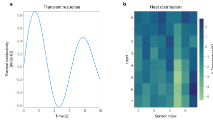
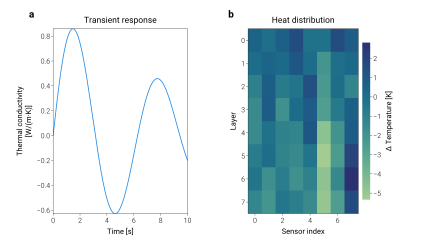

# Layout and Typography

## Layout optimization

For most figures, `simple_layout(fig)` is all you need — it automatically
optimizes margins so labels and titles don't clip or overlap:

```python
import matplotlib.pyplot as plt
import dartwork_mpl as dm
import numpy as np

dm.style.use("scientific")

fig, ax = plt.subplots(figsize=dm.figsize("15cm", "wide"))
ax.plot(np.linspace(0, 10, 100), np.sin(np.linspace(0, 10, 100)), color="dc.teal3")
ax.set_xlabel("Time [s]")
ax.set_ylabel("Response")

dm.simple_layout(fig)  # replaces fig.tight_layout — flush to figure edges
```

**Try it — drag the sliders to see how figure dimensions map onto an A4 page:**

```{raw} html
:file: images/ruler_widget.html
```

### Multi-panel figures

For multi-panel layouts, use GridSpec and pass it to `simple_layout`:

```python
fig = plt.figure(figsize=dm.figsize("15cm", "portrait"))
gs = fig.add_gridspec(2, 2, hspace=0.35, wspace=0.25)
axes = [fig.add_subplot(gs[i, j]) for i in range(2) for j in range(2)]

for ax in axes:
    ax.plot(np.linspace(0, 1, 40), np.random.rand(40), color="dc.teal3", lw=0.8)

dm.label_axes(axes)                    # adds (a), (b), (c), (d) panel labels
dm.set_decimal(axes[0], xn=2, yn=1)    # format tick labels to fixed decimals

# Pass gs so simple_layout respects your GridSpec spacing
dm.simple_layout(fig, gs=gs)
```

:::{figure} images/layout_gridspec.svg
:alt: 2×2 GridSpec layout with panel labels and decimal formatting
:width: 100%
:::

> **Tip:** You generally don't need to set explicit `left`, `right`, `top`,
> `bottom` values on GridSpec — `simple_layout` finds optimal margins
> automatically. Only add manual margins when you need fine positional control
> (e.g., making room for a colorbar or external legend).

## Native multi-panel layouts

Use this setup, choose **one** construction below, then run the shared drawing
and export block. These are executable native matplotlib recipes, not another
layout API. Keep the existing preset, data, colors, fonts, legend and retained
scoped overrides when adapting an existing figure. The example uses a provisional
20 × 16 cm canvas; choose physical dimensions for your page or slide.

```python
import matplotlib.pyplot as plt
import numpy as np
import dartwork_mpl as dm

# Reuse the selected preset for geometry-only revisions.
dm.style.use("scientific")  # report/document: report; talk/slides: presentation
x = np.linspace(0, 12, 121)
fig = plt.figure(figsize=dm.figsize("20cm", "16cm"))
```

### Equal grid

```python
gs = fig.add_gridspec(2, 2, wspace=0.5, hspace=0.65)
axes = {name: fig.add_subplot(gs[i // 2, i % 2])
        for i, name in enumerate("ABCD")}
```

### Global row and column ratios

Every row shares the 2:1 column widths; every column shares the 3:2 row heights.
These ratios concern data rectangles inside the grid, excluding gaps and outer
content margins. They do not partition the entire canvas into percentages.

```python
gs = fig.add_gridspec(2, 2, width_ratios=[2, 1], height_ratios=[3, 2],
                      wspace=0.5, hspace=0.65)
axes = {name: fig.add_subplot(gs[i // 2, i % 2])
        for i, name in enumerate("ABCD")}
```

### Spanning, asymmetric and nested

A spans both rows; D spans the lower right region. B/C share a nested grid.
The shared finish fits outer margins through the root `gs`; nested spacing
remains a native local choice.

```python
gs = fig.add_gridspec(2, 3, wspace=0.75, hspace=0.65)
inner = gs[0, 1:].subgridspec(1, 2, width_ratios=[1, 2], wspace=0.8)
axes = {"A": fig.add_subplot(gs[:, 0]),
        "B": fig.add_subplot(inner[0, 0]),
        "C": fig.add_subplot(inner[0, 1]),
        "D": fig.add_subplot(gs[1, 1:])}
```

### Whole-canvas top 70%, bottom 30%

Here `SubFigure` regions include all local labels and padding. Zero container
spacing makes their heights exactly 70%/30% of the canvas. This explicit 2×1
construction gives each row one full-width plot. Data rectangles become smaller
after local margins.

```python
rows = list(fig.subfigures(2, 1, height_ratios=[7, 3], hspace=0))
panels = rows
axes = {}
for name, panel in zip("AB", panels):
    width_cm = panel.bbox.width / fig.dpi * 2.54
    height_cm = panel.bbox.height / fig.dpi * 2.54
    local = panel.add_gridspec(
        1, 1, left=1.15 / width_cm, right=1 - 0.45 / width_cm,
        bottom=1.05 / height_cm, top=1 - 0.80 / height_cm)
    axes[name] = panel.add_subplot(local[0])
```

For a 2×2 variant with two equal panels per row, replace `panels = rows` with
`panels = [panel for row in rows for panel in row.subfigures(1, 2, wspace=0)]`
and use `zip("ABCD", panels)`. The row containers remain exactly 70%/30%.

### Whole-canvas rows 50:50, top widths 40:60, bottom 70:30

A single global `width_ratios` cannot express this. Allocate independent native
containers within each row. Every percentage includes that panel's labels and
padding; it is not a promise about its Axes data width.

```python
rows = list(fig.subfigures(2, 1, height_ratios=[1, 1], hspace=0))
panels = [*rows[0].subfigures(1, 2, width_ratios=[4, 6], wspace=0),
          *rows[1].subfigures(1, 2, width_ratios=[7, 3], wspace=0)]
axes = {}
for name, panel in zip("ABCD", panels):
    width_cm = panel.bbox.width / fig.dpi * 2.54
    height_cm = panel.bbox.height / fig.dpi * 2.54
    local = panel.add_gridspec(
        1, 1, left=1.15 / width_cm, right=1 - 0.45 / width_cm,
        bottom=1.05 / height_cm, top=1 - 0.80 / height_cm)
    axes[name] = panel.add_subplot(local[0])
```

### Shared drawing, measurement and export

Run this after the chosen construction. For the three ordinary grids use the
`simple_layout` line. For either whole-canvas container recipe **omit that line**:
the explicit native local margins above are the legitimate margin path.
The physical padding is a starting point for these labels, not a universal fit;
render, measure and adjust local margins if content does not fit.

<!-- snippet: no-run -->
```python
from dataclasses import asdict
from pathlib import Path
import json
from matplotlib.ticker import MaxNLocator

for i, (name, ax) in enumerate(axes.items()):
    ax.plot(x, np.sin(x + i), color="oc.blue9", label="Series 1")
    ax.plot(x, np.cos(x + i), color="oc.orange7", label="Series 2")
    ax.set(title=f"{name} · Signal", xlabel="Time (s)", ylabel="Response")
    ax.xaxis.set_major_locator(MaxNLocator(nbins=4))
    ax.yaxis.set_major_locator(MaxNLocator(nbins=4))
    ax.legend(loc="upper right", ncol=2)

# Ordinary GridSpec recipes only; omit for either SubFigure recipe.
dm.simple_layout(fig, gs=gs, margin="2mm")
fig.canvas.draw()
renderer = fig.canvas.get_renderer()
geometry = {"canvas_px": list(fig.bbox.bounds),
            "axes_data_px": {k: list(a.bbox.bounds) for k, a in axes.items()},
            "axes_content_px": {k: list(a.get_tightbbox(renderer).bounds)
                                for k, a in axes.items()}}
# For either container recipe, also record the allocated regions:
# geometry["rows_px"] = [list(row.bbox.bounds) for row in rows]
# geometry["panels_px"] = [list(panel.bbox.bounds) for panel in panels]
# Divide row heights by fig.bbox.height; panel widths by their row width.
# Compare those fractions to the requested ratios, separately from Axes bounds.
report = [asdict(item) for item in dm.validate_figure(fig)]
Path("output").mkdir(exist_ok=True)
Path("output/layout-geometry.json").write_text(json.dumps(geometry, indent=2))
Path("output/layout-report.json").write_text(json.dumps(report, indent=2))
dm.save_formats(fig, "output/layout-v1", formats=("png", "pdf"),
                bbox_inches=None)
```

`dm.simple_layout` needs a parent `Figure`; passing a `SubFigure` raises
`AttributeError` for missing `get_size_inches`. Passing a nested GridSpec with a
parent Figure walks to its root GridSpec and adjusts root outer margins; it
does not solve each nested region independently. Calling it on the root Figure
of a SubFigure tree is not a local-margin solution either. Do not insert fake
helper calls or silently change requested allocations to make validation pass.
Read the full report (including `CHECK_FAILED`), inspect the actual PNG and PDF,
and retain heuristic/advisory warnings with any explanation. Save a revision to
a new stem such as `layout-v2`; keep v1, exact source and geometry for review.

### Adding a buffer with `margin`

The default `simple_layout(fig)` snaps axes content (labels, ticks,
title, legend) flush against the figure edges. For a uniform inset
buffer, pass a `margin`:

```python
fig, ax = plt.subplots(figsize=dm.figsize("9cm", "standard"))
ax.plot(np.linspace(0, 10, 100), np.sin(np.linspace(0, 10, 100)))
ax.set_ylabel("Very Long Label That Might\nOverflow the Figure Bounds")
ax.set_title("Complex Multi-Line Title", fontsize=dm.fs(2))

dm.simple_layout(fig, margin="2%")        # uniform 2% buffer
dm.simple_layout(fig, margin=dm.mm(2))    # uniform 2 mm buffer
dm.simple_layout(fig, ml=dm.cm(1), mr="3%")  # per-side, mixed units
```

`margin` (and the per-side `ml`/`mr`/`mt`/`mb` overrides) accept any
of:

- :class:`Length` (`dm.cm(0.5)`, `dm.mm(5)`, `dm.inch(0.1)`,
  `dm.pt(12)`)
- unit string (`"5mm"`, `"0.5cm"`, `"0.1in"`, `"24pt"`)
- percentage string (`"5%"` = 5 % of the figure dimension)
- bare number (figure-fraction, so `0.05` = 5 %)

**How it works:**

1. Draws the figure once to populate text metrics.
2. Walks every visible artist on each axes (texts, title, axis labels,
   tick labels in view, axis offset text, legend) and computes the
   content-extent overhang relative to each axes' plot area.
3. Sets GridSpec edges arithmetically so the union of all axes
   content sits at exactly the requested distance from each figure
   edge.
4. Re-measures and re-applies until consecutive iterations agree to
   within 0.5 px (typically 2 iterations; up to 8 on AutoLocator
   fixed-points like long log-scale ranges).

No optimizer is involved — the result is fully deterministic.

### Data-range margins on individual axes

`dm.simple_layout` controls margins between the **axes content** and
the **figure edge**. For breathing room between the **plotted data**
and the **axes spines**, use matplotlib's built-in
`ax.margins(...)` — dartwork-mpl doesn't wrap it, since it's already a
one-liner:

```python
ax.margins(x=0.1, y=0.05)   # 10 % x-padding, 5 % y-padding
ax.margins(0.05)            # same value on both axes
```

Useful for:

- Preventing data from touching axis spines
- Creating visual breathing room around markers
- Ensuring scatter points and bar tops aren't clipped at boundaries

### Which call to use?

| Scenario | Call |
|---|---|
| Default — most figures | `dm.simple_layout(fig)` |
| Need a buffer between content and edge | `dm.simple_layout(fig, margin="2%")` or `margin=dm.mm(2)` |
| Per-side asymmetric margins | `dm.simple_layout(fig, ml=dm.cm(1), mr="3%", ...)` |
| Multi-panel via GridSpec | `dm.simple_layout(fig, gs=gs)` |
| Debugging layout convergence | `dm.simple_layout(fig, verbose=True)` |

The historical `dm.auto_layout(fig)` was removed in 0.5.4 and now
raises a migration-hint `AttributeError`. Use `simple_layout` directly.

### `simple_layout` vs `tight_layout`

Simple layouts look fine with either method. The real difference shows up when
figures get more complex — multi-panel grids, long axis labels, colorbars, and
titles all competing for space.

**Interactive visualizer — see how dartwork-mpl calculates margins dynamically:**

```{raw} html
:file: images/layout_debugger.html
```

Below is the **same figure** — a two-panel layout with a multi-line
y-label and a colorbar — rendered with each approach. The figure
background is tinted and edged so you can see how each method
negotiates the gap between the axes content and the figure rectangle
itself. **Click the tabs to toggle** the full-width rendering — that's
the only way to spot the lopsided whitespace and the shifted colorbar
without overlaying the two side-by-side.

::::{tab-set}

:::{tab-item} `simple_layout()` (dartwork-mpl)
:sync: dm


:::

:::{tab-item} `tight_layout()` (matplotlib)
:sync: mpl


:::

::::

**What's different?**

`tight_layout()` calculates padding heuristically — it tries to prevent
overlap but doesn't guarantee uniform margins or optimal use of space. When
panels have **different label lengths** (e.g., a multi-line ylabel vs. a
short one), or when a **colorbar** shifts the effective axes width, the
heuristic can produce lopsided spacing or wasted whitespace.

`simple_layout()` measures every visible artist on every axes and
arithmetically places the GridSpec so the content union lands at the
requested margin from each figure edge. This means:

- **Deterministic** — the same figure produces the same GridSpec
  (no optimizer, no scipy)
- **Content-complete** — sees titles, axis labels, view-limited tick
  labels, ScalarFormatter offset text, legends — everything that
  appears on the canvas
- **GridSpec-native** — pass `gs=gs` and it respects your
  `hspace`/`wspace` while only adjusting outer margins
- **Unit-flexible** — `margin` accepts `Length`, unit strings (`"5mm"`),
  percentages (`"5%"`), or figure-fractions

**Key layout functions** — the full layout API at a glance (for the
`simple_layout` margin / GridSpec options specifically, see
[Which call to use?](#which-call-to-use) above):

| Function                      | What it solves                                                |
| ----------------------------- | ------------------------------------------------------------- |
| `simple_layout(fig, gs=gs)`   | Places content at requested margin — replaces `tight_layout()` |
| `label_axes(axes)`            | Adds (a), (b), (c) labels with auto-positioning for ylabels   |
| `annotate_value(ax, x, y, s)` | Adds compact value labels with vertical/horizontal fallback    |
| `annotate_corner(ax, s)`      | Adds spine-tight narrative notes in the least obstructed corner |
| `label_hline(ax, y, s)`       | Attaches text tightly to a horizontal reference-line endpoint  |
| `place_legend(ax)`            | Places legends around data/text obstacles and can raise ncol   |
| `wrap_axis_label(ax)`         | Wraps an overlong axis label to two word-boundary lines        |
| `arrow_axis(ax, 'x', 'Cost')` | Creates `Low ◄── Cost ──► High` bidirectional annotations     |
| `set_decimal(ax, xn, yn)`     | Fixes tick decimal places for publication-ready labels        |
| `make_offset(x, y, fig)`      | Creates point-based offsets for precise text positioning      |
| `get_bounding_box(boxes)`     | Merges multiple axes bounding boxes into one                  |

## Annotation & Formatting

dartwork-mpl includes several helpers that automate tedious formatting tasks.

### Auto-aligned panel labels (`label_axes`)

Manually positioning `(a)`, `(b)`, `(c)` labels across panels with different y-axis label lengths often results in misaligned text. `dm.label_axes(axes)` calculates the bounding boxes of your y-labels and perfectly aligns the panel labels to the leftmost edge.

**Interactive visualizer — drag the slider to compare:**

```{raw} html
:file: images/label_axes_slider.html
```

### Consistent tick decimals (`set_decimal`)

Raw matplotlib ticks can sometimes mix integers and floats (e.g. `0.5`, `1`, `1.5`), which looks unprofessional. `dm.set_decimal()` forces consistent decimal places for publication-ready formatting.

```{raw} html
:file: images/set_decimal_slider.html
```

### Compact value and reference labels

`dm.annotate_value(ax, x, y, text)` uses a small point offset above the data
point by default, tries below when vertical placement collides, and falls back
to left/right placement when the label would cross the axes spine. Explicit
`side="left"` / `side="right"` also works with `arrowprops`, keeping the arrow
straight along one axis. `dm.annotate_corner(ax, text)` places narrative notes
just inside a corner and can move to a less obstructed corner after rendering.
`dm.label_hline(ax, y, text)` keeps horizontal-reference labels close to the
visible line endpoint with a 2 pt default gap.

```python
dm.annotate_value(ax, x[-1], y[-1], f"{y[-1]:.1f}")
dm.annotate_corner(ax, "Screened subset", loc="upper left")
ax.axhline(baseline, lw=0.5, ls=":")
dm.label_hline(ax, baseline, "Reference", x="auto")
dm.place_legend(ax)
dm.wrap_axis_label(ax, axis="y")
```

### Bidirectional arrow axes (`arrow_axis`)

For conceptual or qualitative plots (like "Risk vs Return"), drawing bidirectional label axes manually is surprisingly difficult in matplotlib. `dm.arrow_axis()` handles the positioning, offsets, and arrows automatically.

:::{figure} images/arrow_axis_example.svg
:alt: Arrow axis example showing Risk vs Expected Return
:width: 100%
:::

## Typography

```python
import dartwork_mpl as dm

dm.style.use("scientific-kr")  # English/Korean fonts set together

fig, ax = plt.subplots(figsize=dm.figsize("9cm", "standard"))
ax.plot([0, 1, 2], [0, 1, 0.4], color="dc.green2", lw=dm.lw(0.5))
ax.set_title("Experiment result", fontsize=dm.fs(2), fontweight=dm.fw(1))
ax.set_xlabel("Time")
ax.set_ylabel("Response")
dm.simple_layout(fig)

# Preview bundled fonts
dm.plot_fonts(ncols=4, font_size=12)
```

:::{figure} images/layout_typography.svg
:alt: Typography demo with fs() and fw() font scaling helpers
:width: 100%
:::

**Scaling helpers:**

| Helper  | What it does                                                                  |
| ------- | ----------------------------------------------------------------------------- |
| `fs(n)` | Font size = base size + `n` points. `fs(0)` = base, `fs(2)` = 2pt larger      |
| `fw(n)` | Weight = base weight + `n` × 100. `fw(0)` = Light (300), `fw(4)` = Bold (700) |
| `lw(n)` | Line width relative to `lines.linewidth`. `lw(0)` = default                   |

See [Font Families](../fonts/families.md) for the full font catalog and
[Font Utilities](../fonts/utilities.md) for detailed usage.

## Before / after — twinx bar + line dashboard

A `twinx` chart is where margin discipline matters most: the left bar
axis, the right line axis, both ylabels, and the legend all compete
for breathing room. Drag the divider to compare vanilla
`tight_layout()` against `dm.simple_layout(fig, margin="2mm")` on the
exact same code.

```{raw} html
:file: ../_static/wipe_l4_dual.html
```

## See also

- **Next →** [Save and Validation](save_export.md) — multi-format export and automatic visual quality checks
- [API › Layout Utilities](../api/layout.rst) for all layout helper functions and arguments
- [Colors and Colormaps](colors.md) for named colors and gradients

:::{image} images/label_axes_vanilla.svg
:class: d-none
:::
:::{image} images/label_axes_dm.svg
:class: d-none
:::
:::{image} images/set_decimal_vanilla.svg
:class: d-none
:::
:::{image} images/set_decimal_dm.svg
:class: d-none
:::
